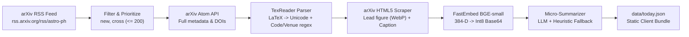
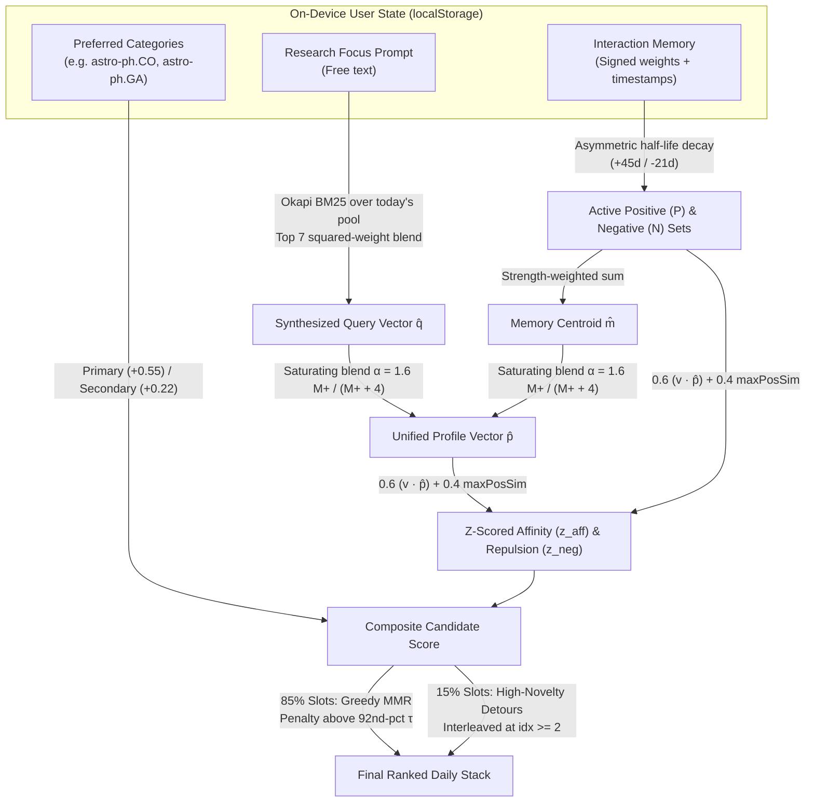

# Periodical

**Periodical** is a calm, finite, zero-backend daily preprint reader for `arXiv` (configured by default for astrophysics, `astro-ph`). Instead of scrolling an overwhelming firehose of 80–150 daily submissions, Periodical distills each morning's announcements into a short, high-signal stack of cards—complete with extracted lead figures, one-line concrete digests, and Zotero-ready BibTeX—ranked entirely on your device.

There are no accounts, no servers, and no telemetry. Your research focus, reading history, learned vector profile, and saved library live exclusively in your browser's `localStorage`.

---

## Table of Contents

1. [Core Features](#core-features)
2. [Where the Papers Come From (The Daily Pipeline)](#where-the-papers-come-from-the-daily-pipeline)
   - [1. arXiv RSS Ingestion & Announcement Filtering](#1-arxiv-rss-ingestion--announcement-filtering)
   - [2. Metadata Enrichment via the arXiv API](#2-metadata-enrichment-via-the-arxiv-api)
   - [3. LaTeX-to-Unicode Sanitization & Signal Extraction](#3-latex-to-unicode-sanitization--signal-extraction)
   - [4. Lead Figure & Caption Extraction from arXiv HTML](#4-lead-figure--caption-extraction-from-arxiv-html)
   - [5. Semantic Embedding & Int8 Vector Quantization](#5-semantic-embedding--int8-vector-quantization)
   - [6. Concrete One-Line Micro-Summaries](#6-concrete-one-line-micro-summaries)
3. [The On-Device Ranking Algorithm](#the-on-device-ranking-algorithm)
   - [Stage 1: Cold-Start Prompt Vector Synthesis via BM25](#stage-1-cold-start-prompt-vector-synthesis-via-bm25)
   - [Stage 2: Implicit & Explicit Behavioral Signal Capture](#stage-2-implicit--explicit-behavioral-signal-capture)
   - [Stage 3: Asymmetric Time Decay & Dynamic Profile Blending](#stage-3-asymmetric-time-decay--dynamic-profile-blending)
   - [Stage 4: Multi-Modal Affinity, Z-Score Standardization & Quality Priors](#stage-4-multi-modal-affinity-z-score-standardization--quality-priors)
   - [Stage 5: Submodular Diversity & Deliberate Exploration ("Detours")](#stage-5-submodular-diversity--deliberate-exploration-detours)
   - [Stage 6: Transparent Selection Explanations](#stage-6-transparent-selection-explanations)
4. [Keyboard Shortcuts & Touch Gestures](#keyboard-shortcuts--touch-gestures)
5. [Zotero & BibTeX Workflow](#zotero--bibtex-workflow)
6. [Running & Configuring Periodical](#running--configuring-periodical)
7. [Architecture & Repository Layout](#architecture--repository-layout)

---

## Core Features

- **Finite Daily Stack:** Choose between **3 and 30 papers per day** (default: 10). Once you finish your stack, you're done until the next arXiv announcement window—though you can always request 5 more papers on demand.
- **Two-Speed Progressive Disclosure:** Skim each card by its **lead figure**, **24-word concrete finding digest**, **title**, **authors**, and **selection reason**. Press `Space` (or tap the card) to unfold the full abstract, figure caption, journal/comment metadata, and direct links (`arXiv`, `HTML`, `PDF`, `Code`, `DOI`).
- **Private, Zero-Backend Personalization:** Combines your written research focus, preferred subject categories, and implicit/explicit reading signals (dwell time, abstract expansions, PDF opens, saves, and fast skips) using 384-dimensional semantic embeddings evaluated directly in the browser.
- **Anti-Filter-Bubble Exploration:** Enforces submodular topic diversity across your daily stack and reserves ~15% of slots for high-quality **Detours** outside your usual neighborhood.
- **Native Lead Figures & Procedural Fallbacks:** Automatically extracts and optimizes the most informative figure and caption from arXiv's HTML5 papers. When a paper has no HTML figure, Periodical renders a deterministic SVG star constellation seeded by the paper's arXiv ID and tinted by its primary category.
- **Frictionless Zotero Integration:** Saving a paper (`→` or `S`) immediately copies a clean, collision-free `@misc` BibTeX entry to your clipboard and queues it in your local Library, tracking which saved papers haven't yet been exported to `.bib`.
- **Portable State:** Export and restore your entire reading memory, preferences, and library as a single JSON file to move seamlessly across devices.

---

## Where the Papers Come From (The Daily Pipeline)

Periodical separates heavy data preparation from personal ranking. A static build script ([`pipeline.py`](file:///Users/jetblack/Desktop/Periodical/pipeline.py)) runs once per arXiv announcement cycle to produce [`data/today.json`](file:///Users/jetblack/Desktop/Periodical/data/today.json) and WebP figures under `data/figs/<YYYY-MM-DD>/`. Every user receives the exact same static bundle; all personalization happens client-side.



### 1. arXiv RSS Ingestion & Announcement Filtering

[`fetch_rss_announcements()`](file:///Users/jetblack/Desktop/Periodical/pipeline.py#L281-L330) queries the official arXiv RSS feed (`https://rss.arxiv.org/rss/<ARXIV_FEED>`, defaulting to `astro-ph`).

- **Announcement types:** Each `<item>` carries an `<arxiv:announce_type>` tag (`new`, `cross`, `replace`, or `replace-cross`). By default, Periodical keeps only **`new`** (fresh submissions in `astro-ph`) and **`cross`** (cross-lists from adjacent archives such as `gr-qc`, `hep-ph`, `physics.*`, `cs.LG`, or `stat.ML`), filtering out minor version replacements.
- **Pool prioritization:** Candidates are sorted by announcement priority (`new` first, then `cross`, `replace`, `replace-cross`) and capped at `MAX_POOL` (default `200`).
- **Weekend & holiday preservation:** Because arXiv only announces Sunday through Thursday nights (20:00 America/New_York), if the RSS feed returns zero matching announcements on a weekend or holiday, the pipeline exits cleanly and leaves the existing `data/today.json` untouched.

### 2. Metadata Enrichment via the arXiv API

Because the RSS feed truncates metadata and lacks author comments or journal references, [`enrich_from_arxiv_api()`](file:///Users/jetblack/Desktop/Periodical/pipeline.py#L333-L367) queries the official arXiv Atom API in batches of 100 IDs (respecting a 3-second politeness delay with retries):

- Replaces RSS author strings with structured author lists (preserving total author count in `n_authors` while capping exported lists at 60 names to keep payload sizes small).
- Orders subject classifications so `primary_category` is guaranteed to be `cats[0]`, followed by secondary cross-listed categories.
- Backfills `comment` (e.g., page counts, figure counts, collaboration notes), `journal_ref`, and `doi`.

### 3. LaTeX-to-Unicode Sanitization & Signal Extraction

Raw arXiv titles, abstracts, and figure captions are full of LaTeX markup (`$\Lambda$CDM`, `$\sim 10^{10}\,\mathrm{M_\odot}$`, `\textit{JWST}`). Rather than shipping a heavy client-side math renderer, [`TexReader`](file:///Users/jetblack/Desktop/Periodical/pipeline.py#L140-L254) and [`clean_tex()`](file:///Users/jetblack/Desktop/Periodical/pipeline.py#L260-L278) parse TeX trees into clean Unicode at build time:

- **Math & Astronomical Symbols:** Maps Greek letters (`\alpha` → `α`, `\Omega` → `Ω`), relations (`\lesssim` → `≲`, `\propto` → `∝`), and astrophysics notation (`\odot` / `\sun` → `☉`, `\oplus` → `⊕`, `\AA` → `Å`, `\arcsec` / `\farcs` → `″`, `\micron` → `μm`).
- **Scripts & Fractions:** Converts short superscripts and subscripts inside math mode into native Unicode glyphs (`10^{-4}` → `10⁻⁴`, `H_0` → `H₀`), formats `\frac{a}{b}` as `a/b`, and `\sqrt{x}` as `√x`.
- **Structural Signals:**
  - **Code repositories ([`find_code_link()`](file:///Users/jetblack/Desktop/Periodical/pipeline.py#L369-L375)):** Scans both the abstract and author comments for URLs hosted on `github.com`, `*.github.io`, `gitlab.com`, `bitbucket.org`, `zenodo.org`, `codeberg.org`, `pypi.org`, `ascl.net`, or `huggingface.co`.
  - **Venue acceptance:** Flags `accepted = True` if `journal_ref` is populated or if the author comment matches `\b(accepted|in press|published|to appear)\b`.

### 4. Lead Figure & Caption Extraction from arXiv HTML

For each paper, [`download_paper_figure()`](file:///Users/jetblack/Desktop/Periodical/pipeline.py#L481-L536) checks whether arXiv has compiled an HTML5 edition at `https://arxiv.org/html/<id>v<version>`:

1. **HTML Parsing ([`ArxivHtmlFigureParser`](file:///Users/jetblack/Desktop/Periodical/pipeline.py#L377-L443)):** Walks `<figure class="ltx_figure">` elements (explicitly excluding `ltx_table`), collecting raster `` dimensions and `<figcaption>` text while converting embedded `<math alttext="...">` nodes back into inline TeX for Unicode sanitization.
2. **Candidate Selection ([`select_best_figure()`](file:///Users/jetblack/Desktop/Periodical/pipeline.py#L445-L469)):** Inspects up to the first 5 figures in the paper, ignores `.svg` icons, selects the largest raster image in each figure by pixel area, and scores candidates using:
   $$\text{score}_{\text{fig}} = -0.6 \cdot \text{rank} - \begin{cases} 1.2 & \text{if aspect ratio } \frac{w}{h} \notin [0.75, 2.1] \\ 0 & \text{otherwise} \end{cases} - \begin{cases} 0.8 & \text{if } n_{\text{imgs}} > 4 \\ 0 & \text{otherwise} \end{cases}$$
   This strongly favors Figure 1 unless it has an extreme panoramic/skyscraper aspect ratio or is a fragmented multi-panel grid.
3. **WebP Optimization:** Downloads the winning image, rejects tiny thumbnails (`< 160×100`), composites transparent RGBA/palette images onto a crisp white canvas, downscales to fit within `1100×1100` px (`Image.LANCZOS`), and saves as WebP (`quality=76, method=6`). Old figure directories beyond `KEEP_DAYS` (default `3`) are pruned automatically.

### 5. Semantic Embedding & Int8 Vector Quantization

[`compute_embeddings()`](file:///Users/jetblack/Desktop/Periodical/pipeline.py#L562-L575) embeds every paper's `"<title>. <abstract>"` using **`BAAI/bge-small-en-v1.5`** (via `fastembed`), producing a 384-dimensional L2-normalized `float32` vector $\mathbf{v} \in \mathbb{R}^{384}$.

To keep `data/today.json` lightweight (~220 KB for 200 papers) without sacrificing cosine similarity accuracy, each unit vector is symmetrically quantized to signed 8-bit integers (`int8`) and Base64-encoded:

$$q_d = \operatorname{clip}\!\left(\operatorname{round}\!\left(\frac{v_d}{\max_k |v_k|} \times 127\right), -127, 127\right) \in \mathbb{Z}_8$$

Each 384-D vector occupies just **384 bytes** (512 Base64 characters). In the browser, [`decodeVector()`](file:///Users/jetblack/Desktop/Periodical/js/vectors.js#L20-L34) decodes the bytes and L2-normalizes the resulting `Float32Array`, recovering the original unit direction since global scale cancels out upon normalization.

### 6. Concrete One-Line Micro-Summaries

Every card leads with a single-sentence digest (`micro`) designed for rapid triage ([`generate_summaries()`](file:///Users/jetblack/Desktop/Periodical/pipeline.py#L622-L689)):

- **LLM Digest (Primary):** Queries an OpenAI-compatible chat completion API (defaulting to `openai/gpt-4o-mini` in batches of 8, caching previous runs by paper ID) with a strict system prompt: *one sentence of at most 24 words stating the concrete finding, measurement, model, or prediction with its key number, never starting with meta-phrases like "This paper" or "We show"*.
- **Extractive Heuristic Fallback ([`build_heuristic_summary()`](file:///Users/jetblack/Desktop/Periodical/pipeline.py#L588-L620)):** When no API key is configured—or if an API call fails—Periodical falls back to a deterministic sentence scorer over the abstract:
  $$\text{score}_{\text{sent}}(i, s) = 2.0 \cdot \mathbb{I}[\text{finding cue in } s] + 0.8 \cdot \frac{i}{N_{\text{sents}}} - 1.5 \cdot \mathbb{I}[\text{words}(s) > 45]$$
  It strips boilerplate prefixes (*"In this study, our results show that..."*) and truncates cleanly at a clause boundary around 28 words.

---

## The On-Device Ranking Algorithm

All ranking logic lives in [`js/ranking.js`](file:///Users/jetblack/Desktop/Periodical/js/ranking.js), [`js/state.js`](file:///Users/jetblack/Desktop/Periodical/js/state.js), and [`js/vectors.js`](file:///Users/jetblack/Desktop/Periodical/js/vectors.js). Whenever a new daily feed loads—or when you update your preferences—[`rankCandidatePool()`](file:///Users/jetblack/Desktop/Periodical/js/ranking.js#L124-L278) executes a six-stage pipeline in under a few milliseconds.



### Stage 1: Cold-Start Prompt Vector Synthesis via BM25

A key architectural challenge in a zero-backend app is matching a user's free-text **Research focus** prompt against 384-dimensional neural paper embeddings without downloading a 100+ MB embedding model into the browser.

[`synthesizePromptVector()`](file:///Users/jetblack/Desktop/Periodical/js/ranking.js#L22-L89) solves this by using today's 200-paper pool as a **lexical-to-semantic bridge**:

1. **Tokenization & Light Stemming ([`tokenizeText()`](file:///Users/jetblack/Desktop/Periodical/js/ranking.js#L13-L18)):** Lowercases text, strips stop words and tokens $\le 2$ chars, and normalizes plurals (`galaxies` → `galaxy`, `simulations` → `simulation`).
2. **Okapi BM25 Scoring:** Treats each paper in today's pool as a document where title tokens are weighted $2\times$ (`"${title} ${title} ${abstract}"`). For query terms $t \in Q$:
   $$\operatorname{IDF}(t) = \ln\!\left(1 + \frac{N - \operatorname{df}(t) + 0.5}{\operatorname{df}(t) + 0.5}\right), \quad \operatorname{BM25}(d, Q) = \sum_{t \in Q} \operatorname{IDF}(t) \cdot \frac{f_{t,d} \cdot (k_1 + 1)}{f_{t,d} + k_1 \left(1 - b + b \frac{|d|}{\text{avgdl}}\right)}$$
   with standard parameters $k_1 = 1.2$ and $b = 0.75$.
3. **Squared-Score Embedding Synthesis:** Takes the top $K = 7$ BM25-matching papers from today's pool and combines their neural BGE embeddings $\mathbf{v}_k$ with squared relative weights so strong lexical matches dominate:
   $$w_k = \left(\frac{\operatorname{BM25}_k}{\max_{j} \operatorname{BM25}_j}\right)^2, \quad \hat{\mathbf{q}} = \operatorname{normalize}\!\left(\sum_{k=1}^{\min(7, |D_+|)} w_k \mathbf{v}_k\right)$$

Even if a relevant paper shares **zero exact keywords** with your prompt, it will still rank highly if its neural embedding $\mathbf{v}$ is close to the synthesized concept vector $\hat{\mathbf{q}}$.

### Stage 2: Implicit & Explicit Behavioral Signal Capture

As you triage cards, Periodical tracks two per-paper metrics in [`js/state.js`](file:///Users/jetblack/Desktop/Periodical/js/state.js#L149-L210):
- **Interaction Phase (`ph`):** `0` (*Seen*), `1` (*Read* — expanded abstract), `2` (*Opened* — clicked PDF or HTML), `3` (*Saved* — added to Library).
- **Active Dwell Time (`dw`):** Milliseconds spent with the card visible in the foreground (automatically paused on `visibilitychange` when switching tabs or windows).

[`computeSignalWeight()`](file:///Users/jetblack/Desktop/Periodical/js/state.js#L149-L172) converts these actions into a signed learning weight $w \in [-1.0, +1.0]$ stored alongside the paper's quantized vector in `state.mem`:

| User Action / Engagement Level | Condition | Signal Weight ($w$) |
| :--- | :--- | :--- |
| **Saved to Library** | Paper is in `state.lib` | **`+1.00`** *(softened to `+0.60` if later un-saved)* |
| **Opened Full Paper** | Clicked **Open PDF** or **HTML** (`phase >= 2`) | **`+0.70`** |
| **Read Abstract** | Expanded card (`phase == 1`), scaled by dwell time | **`+0.28` to `+0.45`** $\left(0.28 + \min\!\left(0.17, \frac{\text{dwellMs}}{90000} \times 0.17\right)\right)$ |
| **Passive Navigation** | Moved away without explicit skip and `phase == 0` | *No signal recorded (`null`)* |
| **Slow Explicit Skip** | Pressed Skip (`←` / `X` / swipe left) after $\ge 9\text{ s}$ | **`-0.15`** |
| **Medium Explicit Skip** | Pressed Skip between $3.5\text{ s}$ and $9\text{ s}$ | **`-0.50`** |
| **Fast Explicit Skip** | Pressed Skip in $< 3.5\text{ s}$ on collapsed card | **`-1.00`** |

### Stage 3: Asymmetric Time Decay & Dynamic Profile Blending

Research interests evolve, and skipping a paper on a busy morning shouldn't permanently banish a topic. [`getDecayedMemoryVectors()`](file:///Users/jetblack/Desktop/Periodical/js/ranking.js#L91-L122) applies exponential decay based on the elapsed age $\Delta t$ (in days) using **asymmetric half-lives**:

$$s_i = |w_i| \cdot 0.5^{\Delta t_i / T_{1/2}}, \quad \text{where } T_{1/2} = \begin{cases} 45\text{ days} & \text{if } w_i > 0 \text{ (positive signals persist)} \\ 21\text{ days} & \text{if } w_i < 0 \text{ (negative skips fade } >2\times \text{ faster)} \end{cases}$$

Entries whose decayed strength falls below $s_i < 0.03$ are ignored, and at most the top 160 positive ($P$) and 160 negative ($N$) signals are kept active.

Next, Periodical computes the positive memory centroid $\hat{\mathbf{m}}$ with total positive mass $M_+ = \sum_{i \in P} s_i$:

$$\hat{\mathbf{m}} = \operatorname{normalize}\!\left(\sum_{i \in P} s_i \mathbf{v}_i\right)$$

and blends it with the prompt vector $\hat{\mathbf{q}}$ using a saturating Michaelis–Menten curve:

$$\alpha = \frac{1.6\, M_+}{M_+ + 4}, \quad \hat{\mathbf{p}} = \operatorname{normalize}\!\left(\hat{\mathbf{q}} + \alpha \hat{\mathbf{m}}\right)$$

- **Day 1 ($M_+ = 0 \implies \alpha = 0$):** Your explicit research focus prompt $\hat{\mathbf{q}}$ drives 100% of the profile vector.
- **After ~4 saved papers ($M_+ = 4 \implies \alpha = 0.8$):** Learned history and explicit prompt contribute nearly equally.
- **Mature profile ($M_+ \gg 4 \implies \alpha \to 1.6$):** What you actually read, open, and save takes the lead while your prompt remains a steady anchor.

### Stage 4: Multi-Modal Affinity, Z-Score Standardization & Quality Priors

A single average centroid $\hat{\mathbf{p}}$ can blur distinct sub-interests (for instance, if you follow both *exoplanet atmospheres* and *fast radio bursts*, their average lies in an empty region of embedding space). Periodical preserves multi-modal interests by combining **global profile similarity** with **local exemplar similarity** (nearest positive neighbor) and **nearest negative repulsion**:

$$s_{\text{pos}}(\mathbf{v}) = \max_{i \in P} \Big[(\mathbf{v} \cdot \mathbf{v}_i) \cdot \min(1,\, 0.5 + 0.5 s_i)\Big]$$

$$s_{\text{neg}}(\mathbf{v}) = \max_{j \in N} \Big[(\mathbf{v} \cdot \mathbf{v}_j) \cdot \min(1,\, 0.4 + 0.6 s_j)\Big]$$

$$\operatorname{affinity}(\mathbf{v}) = \begin{cases} 0.6\,(\mathbf{v} \cdot \hat{\mathbf{p}}) + 0.4\,s_{\text{pos}}(\mathbf{v}) & \text{if } |P| \ge 2 \\ \mathbf{v} \cdot \hat{\mathbf{p}} & \text{otherwise} \end{cases}$$

Because raw cosine similarities in transformer embedding spaces occupy a narrow positive cone, [`computeZScores()`](file:///Users/jetblack/Desktop/Periodical/js/vectors.js#L72-L89) standardizes both $\operatorname{affinity}(\mathbf{v})$ and $s_{\text{neg}}(\mathbf{v})$ across today's candidate pool to zero mean and unit variance ($z_{\text{aff}}$ and $z_{\text{neg}}$). That guarantees additive priors have consistent leverage every day:

$$\operatorname{score}(\mathbf{v}) = z_{\text{aff}}(\mathbf{v}) - w_{\text{neg}} \max\!\big(0, z_{\text{neg}}(\mathbf{v})\big) + Q(\mathbf{v}) + C(\mathbf{v}) + \epsilon$$

where:
- **Negative Damping ($w_{\text{neg}}$):** $w_{\text{neg}} = 0.7 \min(1, |N| / 6)$, which ramps up smoothly as negative skips accumulate and only penalizes papers with above-average similarity to your skipped items ($z_{\text{neg}} > 0$).
- **Structural Quality Prior ($Q$):**
  $$Q = +0.32\,\mathbb{I}[\text{has code link}] + 0.18\,\mathbb{I}[\text{accepted/published}] + 0.12\,\mathbb{I}[\text{has extracted figure}] - 0.15\,\mathbb{I}[\text{cross-list}]$$
- **Category Preference Boost ($C$):** When you select preferred areas in Settings:
  - $+0.55$ if the paper's **primary** category (`cats[0]`) is in your preferred set.
  - $+0.22$ if any **secondary** category matches.
  - $-0.15$ if none of its categories match.
- **Deterministic Daily Jitter ($\epsilon$):** $\epsilon = (u - 0.5) \times 0.14 \in [-0.07, +0.07]$, drawn from a Mulberry32 PRNG seeded by `pool.date`.

### Stage 5: Submodular Diversity & Deliberate Exploration ("Detours")

Ranking purely by $\operatorname{score}(\mathbf{v})$ would pack your stack with near-duplicate papers when a large collaboration drops 6 companion papers on the same day. Periodical prevents clustering and filter bubbles in two ways:

1. **Adaptive Pool Similarity Threshold ($\tau$):** On feed load, [`estimateSimilarityThreshold()`](file:///Users/jetblack/Desktop/Periodical/js/state.js#L134-L147) samples pairwise cosine similarities across today's papers and sets $\tau$ to the **92nd percentile** (typically $\tau \approx 0.79\text{–}0.82$).
2. **Greedy Redundancy-Penalized Selection (85% of stack):** For the main exploitation slots ($N_{\text{main}} = N_{\text{target}} - N_{\text{explore}}$), Periodical greedily picks the candidate maximizing:
   $$\operatorname{score}_{\text{MMR}}(\mathbf{v}) = \operatorname{score}(\mathbf{v}) - 1.7 \cdot \frac{\max(0,\, r(\mathbf{v}) - \tau)}{1 - \tau}, \quad \text{where } r(\mathbf{v}) = \max_{\mathbf{u} \in S_{\text{picked}}} (\mathbf{v} \cdot \mathbf{u})$$
   Below $\tau$, there is zero diversity penalty; above $\tau$, the linear overflow penalty rapidly suppresses redundant companion papers.
3. **Deliberate Exploration / "Detours" (15% of stack):** Whenever personalization is active and $N_{\text{target}} \ge 4$, Periodical reserves $N_{\text{explore}} = \max(1, \operatorname{round}(0.15\, N_{\text{target}}))$ slots for serendipitous discovery. Exploration picks maximize **novelty** relative to both today's already-selected stack and your historical positive memory, while still respecting quality priors and avoiding your skipped topics:
   $$\operatorname{novelty}(\mathbf{v}) = 1 - \max\!\big(r(\mathbf{v}),\, s_{\text{pos}}(\mathbf{v})\big)$$
   $$\operatorname{score}_{\text{explore}}(\mathbf{v}) = 3.2 \cdot \operatorname{novelty}(\mathbf{v}) + 0.6\, Q(\mathbf{v}) - 0.8 \max\!\big(0, z_{\text{neg}}(\mathbf{v})\big) + 0.9\,\text{jitter}$$
   Each exploration pick is badged with a **Detour** flag and interleaved evenly into the stack at index $\ge 2$ so your top two morning cards are always high-confidence matches.

### Stage 6: Transparent Selection Explanations

Every selected card is annotated by [`explainSelection()`](file:///Users/jetblack/Desktop/Periodical/js/ranking.js#L280-L297) with the strongest human-readable reason why it made your stack:

1. **Detour:** *"Outside your usual — a deliberate detour"* (`isExplore === true`)
2. **Exemplar Match:** *"Close to “\<Title of previously liked paper\>”"* ($s_{\text{pos}} > \tau + 0.02$)
3. **Focus Match:** *"Matches your research focus"* ($\hat{\mathbf{q}}$ present and $z_{\text{aff}} > 0.9$)
4. **Category Match:** *"From \<Category Name\>"* (`cats[0]` in preferred categories)
5. **Open Science Signal:** *"Ships with code"* (`paper.code` present)

---

## Keyboard Shortcuts & Touch Gestures

Periodical is designed for rapid, single-keystroke triage on desktop and fluid one-handed gestures on mobile.

| Key / Gesture | Action |
| :--- | :--- |
| <kbd>Space</kbd> | Unfold the abstract & details; press again to scroll down (<kbd>Shift</kbd>+<kbd>Space</kbd> scrolls up) |
| <kbd>Enter</kbd> / <kbd>O</kbd> / <kbd>P</kbd> | Open the arXiv PDF in a new tab (promotes card to *Opened*) |
| <kbd>→</kbd> / <kbd>S</kbd> / **Swipe Right** | Save paper to Library, copy BibTeX to clipboard, and advance |
| <kbd>←</kbd> / <kbd>X</kbd> / <kbd>D</kbd> / **Swipe Left** | Skip paper, record negative signal, and advance |
| <kbd>U</kbd> / <kbd>Backspace</kbd> / <kbd>Z</kbd> | Go back to the previous paper |
| <kbd>F</kbd> / **Tap Figure** | Enlarge the lead figure & caption in a full-screen lightbox |
| <kbd>C</kbd> | Copy the current paper's BibTeX entry to the clipboard |
| <kbd>L</kbd> | Open your saved Library |
| <kbd>,</kbd> | Open Preferences (research focus, categories, daily limit, theme, backups) |
| <kbd>?</kbd> | Open the keyboard shortcuts reference |
| <kbd>Esc</kbd> | Collapse an expanded card (or close an open dialog) |

---

## Zotero & BibTeX Workflow

[`js/bibtex.js`](file:///Users/jetblack/Desktop/Periodical/js/bibtex.js) generates standards-compliant `@misc` BibTeX records tailored for astrophysics and Zotero:

- **Citation Keys:** Automatically formatted as `<firstauthor><year><first_significant_title_word>` (e.g., `smith2026jwst`), with automatic `a, b, c...` disambiguation on collisions.
- **Author Parsing ([`formatBibtexAuthor()`](file:///Users/jetblack/Desktop/Periodical/js/bibtex.js#L31-L47)):** Properly handles nobiliary particles (`van der Waals, Johannes`, `de la Fuente Marcos, C.`), generational suffixes (`Jr.`, `III`), and collaboration names (wrapping `JWSTero Collaboration` or `DESI Collaboration` in protective braces `{...}`).
- **Incremental Export Tracking:** Your Library tracks which saved papers have already been exported (`exported: true/false`). The header badge shows the count of **unexported** saves, and clicking **Export N new to Zotero** downloads a `.bib` file (or invokes the native mobile share sheet) containing only your newly saved papers.

---

## Running & Configuring Periodical

### Viewing the App Locally

Because Periodical is a static ES module web application that fetches `data/today.json`, serve the root directory over any local HTTP server:

```bash
python3 -m http.server 8000
```

Then open `http://localhost:8000` in your browser.

### Running the Daily Data Pipeline

To fetch the latest arXiv announcements, extract HTML figures, compute `BAAI/bge-small-en-v1.5` embeddings, and generate `data/today.json`:

```bash
pip install requests numpy arxiv Pillow fastembed openai
python3 pipeline.py
```

#### Pipeline Environment Variables

You can customize [`pipeline.py`](file:///Users/jetblack/Desktop/Periodical/pipeline.py#L20-L33) for different arXiv archives, pool sizes, or LLM providers using environment variables:

| Variable | Default | Description |
| :--- | :--- | :--- |
| `ARXIV_FEED` | `astro-ph` | Target arXiv RSS feed (e.g. `astro-ph`, `gr-qc`, `hep-th`, `quant-ph`, `cs.LG`) |
| `MAX_POOL` | `200` | Maximum number of announced papers to process per day |
| `ANNOUNCE_TYPES` | `new,cross` | Comma-separated announcement types to include (`new`, `cross`, `replace`, `replace-cross`) |
| `OUT_DIR` | `data` | Output directory for `today.json` and `figs/<YYYY-MM-DD>/` |
| `KEEP_DAYS` | `3` | Number of days of historical figure directories to retain before pruning |
| `FIG_MAX_PX` | `1100` | Maximum bounding dimension (px) for downscaled WebP lead figures |
| `FIG_WORKERS` | `4` | Concurrent thread workers for downloading arXiv HTML pages and figures |
| `LLM_API_KEY` | *(optional)* | API key for LLM micro-summaries (also falls back to `GITHUB_TOKEN`; uses heuristic if unset) |
| `LLM_BASE_URL` | `https://models.github.ai/inference` | OpenAI-compatible inference base URL |
| `LLM_MODEL` | `openai/gpt-4o-mini` | Model identifier used for 24-word single-sentence digests |
| `LLM_BATCH` | `8` | Number of papers summarized per LLM chat completion request |

---

## Architecture & Repository Layout

```text
Periodical/
├── index.html          # App shell, semantic dialogs (Preferences, Library, Shortcuts, Lightbox)
├── pipeline.py         # Daily build script: RSS -> API -> TeX clean -> HTML figs -> BGE int8 -> LLM/heuristic
├── data/
│   ├── today.json      # Static daily payload (metadata, micro-summaries, Base64 int8 embeddings)
│   └── figs/           # Extracted WebP lead figures organized by announcement date (YYYY-MM-DD)
├── js/
│   ├── main.js         # Entry point, lifecycle listeners, keyboard & dialog wiring
│   ├── ranking.js      # BM25 prompt synthesis, decay memory, Z-score scoring, MMR diversity & Detours
│   ├── state.js        # localStorage persistence, feed ingestion, dwell timer, signal weights
│   ├── vectors.js      # Int8 Base64 vector decoding/encoding, L2 normalization, dot products, Z-scores
│   ├── actions.js      # Card expansion, phase promotion, save/skip/undo transitions, touch swipe physics
│   ├── views.js        # Card rendering, onboarding view, caught-up summary, constellation SVG fallback
│   ├── dialogs.js      # Library filtering & export, Preferences management, JSON backup/restore
│   ├── bibtex.js       # Author particle/collaboration parser, citation key generator, .bib exporter
│   ├── config.js       # Constants, default state, arXiv category human names, stop words
│   ├── utils.js        # Mulberry32 seeded PRNG, FNV-1a hashing, author abbreviation, procedural stars
│   ├── ui.js           # Theme switching (Auto/Light/Dark), figure lightbox, toast notifications
│   └── icons.js        # Inline SVG icon definitions
└── css/
    ├── base.css        # Design tokens, light/dark color palettes, typography (Newsreader & Inter)
    ├── layout.css      # App shell, top bar, segmented progress bar, bottom action dock
    ├── card.css        # Paper card, lead figure plate, stamps, progressive disclosure transitions
    ├── views.css       # Onboarding, review complete tally, and empty state views
    ├── dialogs.css     # Modal dialogs, category chips, library items, keyboard shortcut grid
    └── responsive.css  # Mobile & small-viewport adaptations
```
